<div align="center">

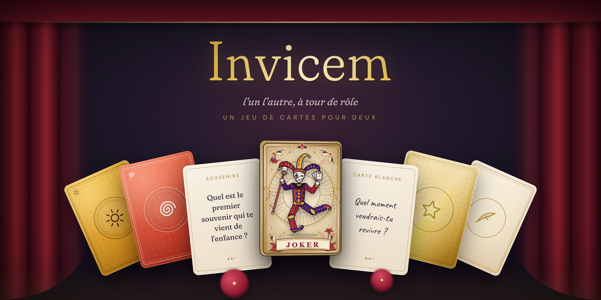

<br><br>

### ▶ Jouer maintenant : **[invicem.vercel.app](https://invicem.vercel.app)**

*invicem* — latin : « l'un l'autre, à tour de rôle »

**Un jeu de cartes pour deux, pour se découvrir une question après l'autre.**
Assis côte à côte, un téléphone chacun. Rien à installer : ouvrez le lien sur les deux téléphones.

<br>

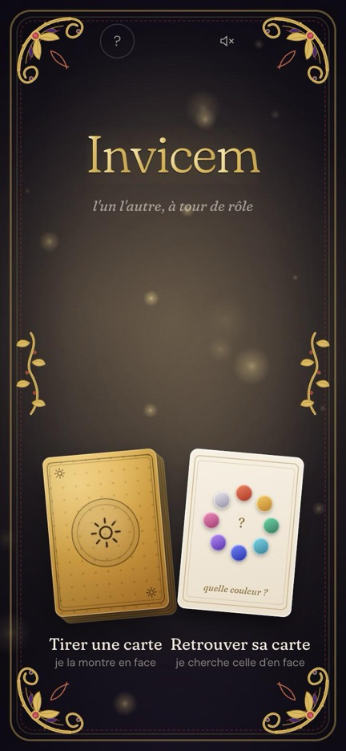 &nbsp; 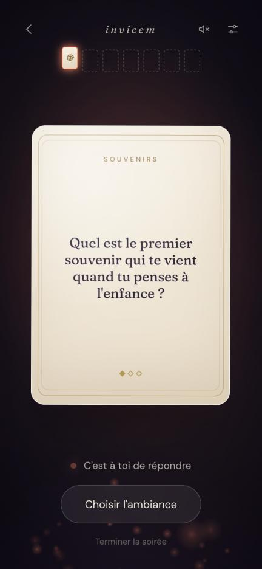 &nbsp; 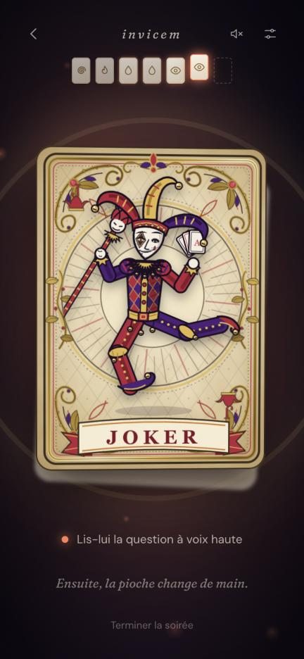

</div>

---

## Le principe

<p align="center">
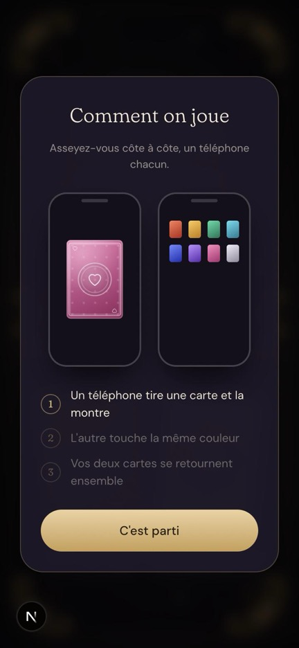
</p>

1. **La rencontre.** L'un tire une carte : elle apparaît face cachée, avec un dos unique (une couleur et un symbole). L'autre regarde l'écran d'en face et touche la même couleur. Les deux cartes se retournent **au même instant** sur les deux téléphones.
2. **L'ambiance.** Ensemble, vous choisissez jusqu'où aller ce soir (*Effleurer*, *Se confier*, *Se dévoiler*) et de quoi parler. La profondeur monte d'elle-même au fil de la soirée.
3. **Le jeu.** Celui qui pioche choisit une carte parmi trois (thème et profondeur visibles, question cachée) et la lit à voix haute. L'autre l'écoute, carte face cachée, puis répond. Celui qui a répondu pioche à son tour.
4. **La fin.** Après sept questions, une carte de clôture, puis chacun scelle **un mot** pour la soirée. Les deux mots se révèlent ensemble, et la soirée se résume en une carte.

### En images

<table>
<tr>
<td align="center">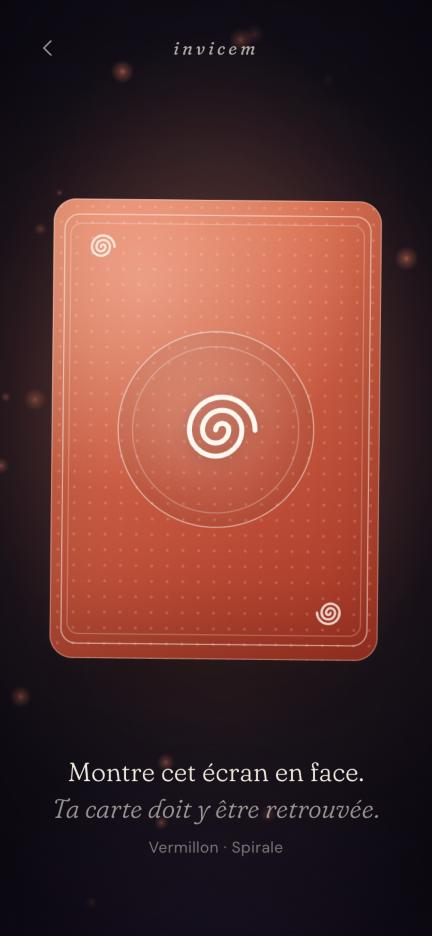<br><sub><b>1. Tirer</b><br>un dos unique, montré en face</sub></td>
<td align="center">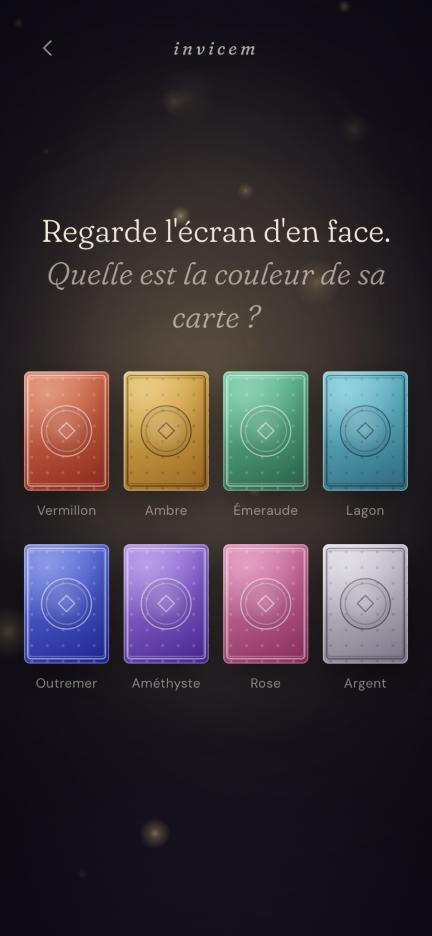<br><sub><b>2. Retrouver</b><br>toucher la même couleur</sub></td>
<td align="center">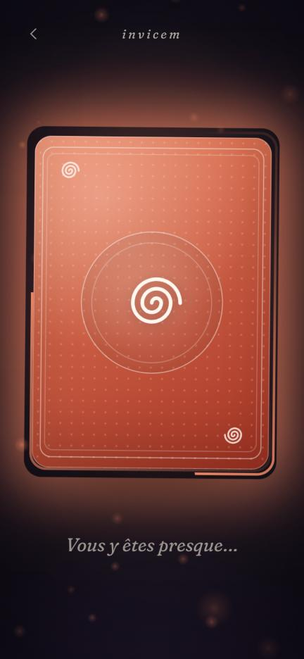<br><sub><b>3. La charge</b><br>les deux cartes s'éveillent</sub></td>
</tr>
<tr>
<td align="center"><br><sub><b>4. Le retournement</b><br>au même instant, sur les deux écrans</sub></td>
<td align="center">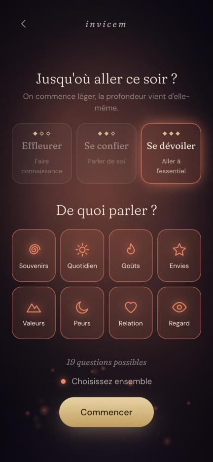<br><sub><b>5. L'ambiance</b><br>jusqu'où, et de quoi parler</sub></td>
<td align="center">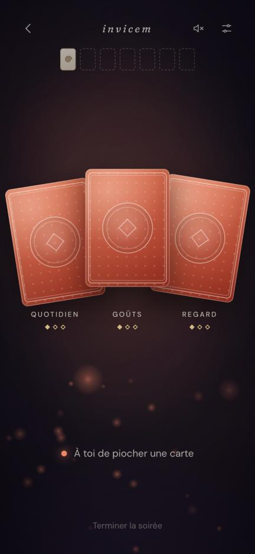<br><sub><b>6. Piocher</b><br>trois cartes, la question cachée</sub></td>
</tr>
<tr>
<td align="center">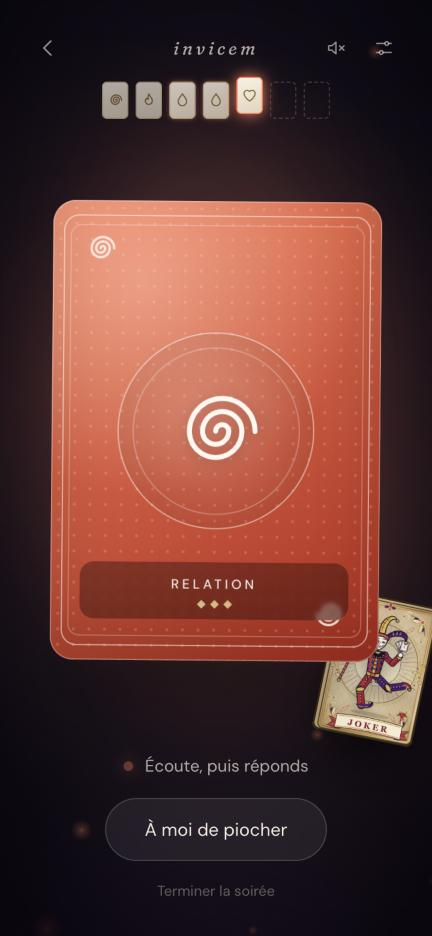<br><sub><b>7. Écouter</b><br>la carte reste face cachée</sub></td>
<td align="center"><br><sub><b>8. Le joker</b><br>passer une question, en dansant</sub></td>
<td align="center">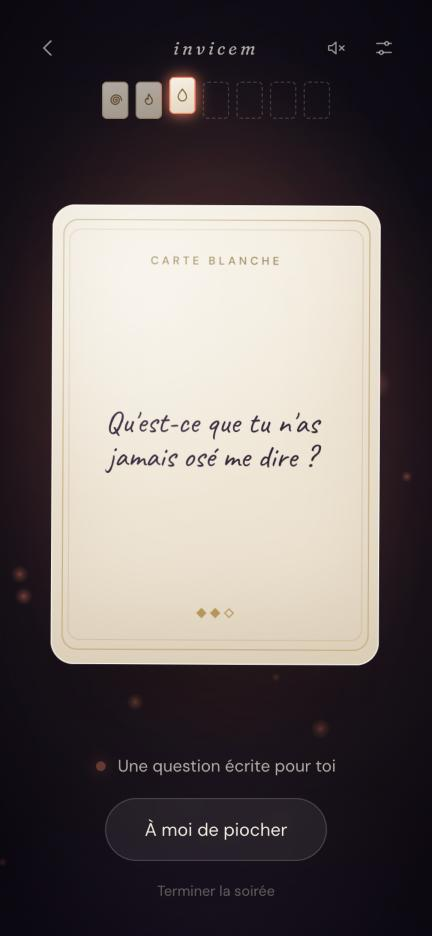<br><sub><b>9. La carte blanche</b><br>une question écrite à la main</sub></td>
</tr>
<tr>
<td align="center">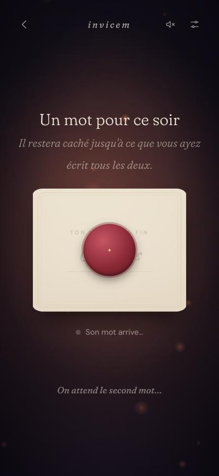<br><sub><b>10. Un mot</b><br>scellé à la cire</sub></td>
<td align="center">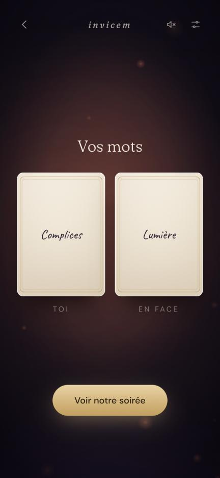<br><sub><b>11. La révélation</b><br>les deux mots, ensemble</sub></td>
<td align="center">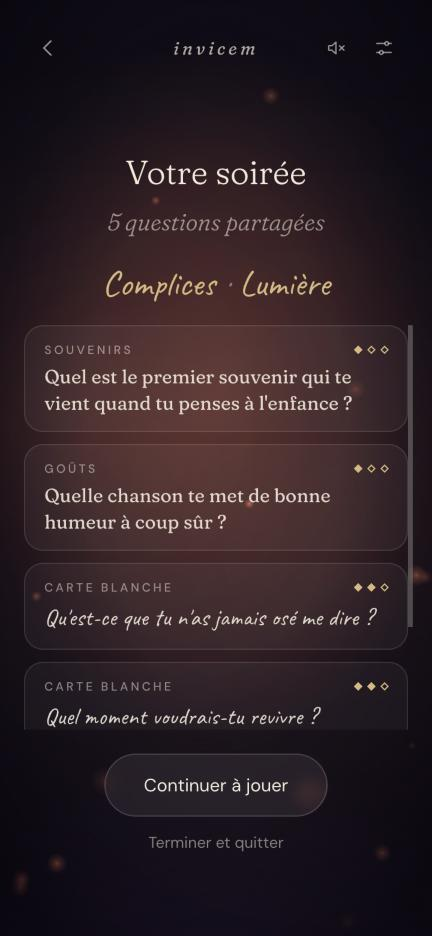<br><sub><b>12. Votre soirée</b><br>le souvenir de la partie</sub></td>
</tr>
</table>

### Les cartes spéciales

| | |
|---|---|
| **Joker** | Un par joueur et par soirée : passer une question, avec un bouffon qui danse sur la table. |
| **Carte blanche** | Proposée à chacun : on écrit sa propre question, que l'autre voit s'écrire à la main. |
| **Cartes rares** | Dorées et holographiques, environ une main sur huit : des questions plus audacieuses. |

### Les règles de connexion

Pas de code, pas de lien, pas de caméra ni de micro : les deux personnes sont ensemble, l'identification passe par les yeux et les doigts.

- 8 couleurs × 12 symboles. Chaque dos est **réservé** à sa carte pendant 2 minutes, puis libéré.
- Si une couleur est libre, l'autre n'a qu'un toucher à faire ; sinon, couleur puis symbole.
- La limite porte sur les cartes en attente au même moment (96), pas sur le nombre de joueurs.

## Sous le capot

- **[Next.js](https://nextjs.org)** (App Router) — pages et API au même endroit.
- **[Tailwind CSS](https://tailwindcss.com)** — mise en page.
- **[GSAP](https://gsap.com)** — toutes les animations : retournements, distribution, joker, profondeur.
- **État partagé** : en mémoire en développement, **[Upstash Redis](https://upstash.com)** en production (offre gratuite, accessible depuis Vercel).
- **Synchronisation** : les deux téléphones interrogent le serveur (1 à 1,5 s). Les moments partagés sont calés sur l'horloge du serveur, corrigée de la latence.
- Son (WebAudio), vibration (Android), gyroscope (https) : tout est optionnel et respecte « réduire les animations ».

```
app/           pages, API (card, find, session/*), icônes, manifest
components/    écrans (Home, Finder, Stage), cartes, main, joker, ambiance
lib/           règles du jeu (game.ts), questions, stockage, palette
```

## Lancer en local

```bash
npm install
npm run dev
```

Ouvrir http://localhost:3000. Pour jouer à deux sur le même réseau, ouvrir l'adresse IP de l'ordinateur sur les téléphones (par exemple `http://192.168.1.67:3000`).

Sans variables d'environnement, l'état vit en mémoire : parfait pour tester, effacé au redémarrage.

## Déployer (gratuit)

1. Créer une base **Upstash Redis** (offre gratuite).
2. Importer le dépôt sur **Vercel** et définir :

   ```
   UPSTASH_REDIS_REST_URL=...
   UPSTASH_REDIS_REST_TOKEN=...
   ```

   (ou les variables `KV_REST_API_URL` / `KV_REST_API_TOKEN` fournies par l'intégration Vercel).
3. Sur iPhone, ouvrir le site (par exemple https://invicem.vercel.app) dans Safari puis **Partager → Sur l'écran d'accueil** : l'app s'ouvre en plein écran.

## Les questions

La banque de départ est un exemple, dans `lib/questions.ts` : chaque question a un thème et une profondeur (1 léger, 2 personnel, 3 profond). Les cartes rares ont leur propre liste.

---

<div align="center"><sub>Fait pour les soirées où l'on prend le temps.</sub></div>
